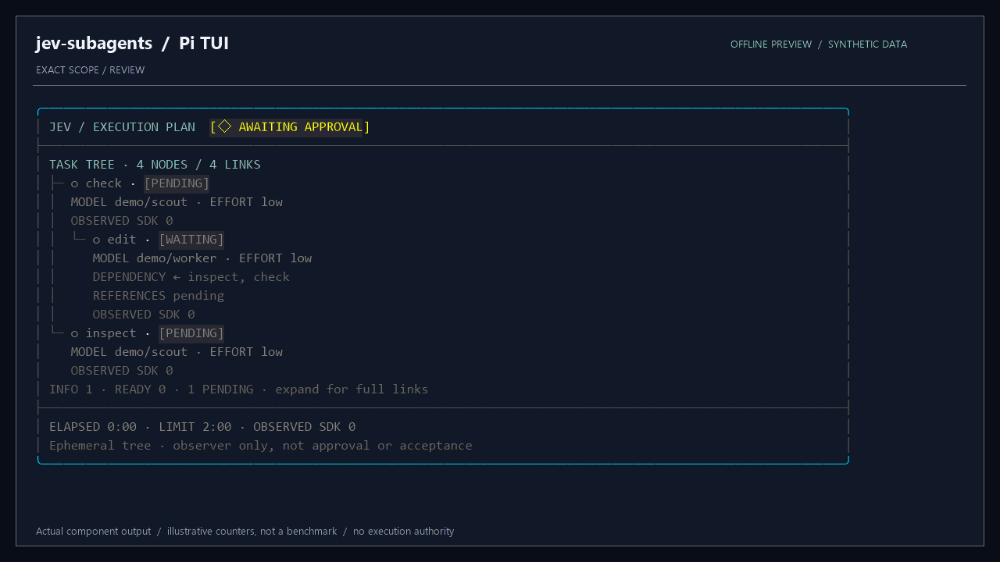
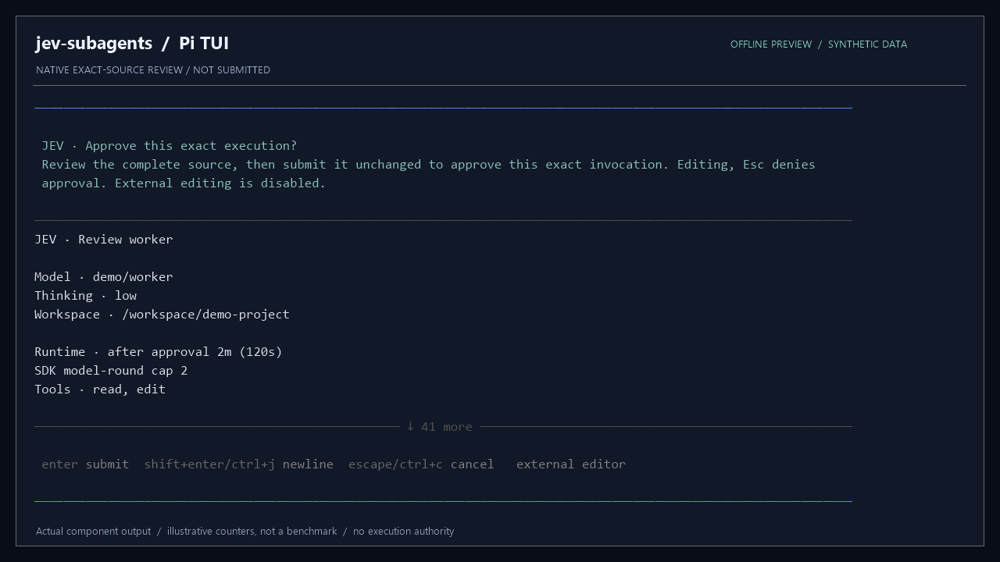
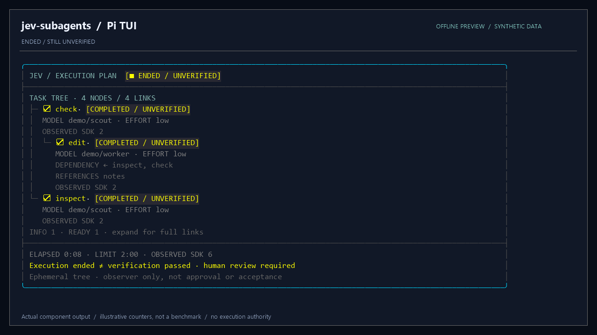

<div align="center">

# jev-subagents

**Route when needed. Review the exact scope. Follow every worker.**

JEV-assisted subagents for [Pi](https://pi.dev), with native terminal plans, explicit worker permissions and bounded reference sharing.

[**Download v1.0.0**](https://github.com/mud-the-developer/jev-subagents/releases/tag/v1.0.0) · [Installation](docs/installation.md) · [Usage](docs/usage.md) · [Security](docs/security.md)

</div>

[](https://github.com/mud-the-developer/jev-subagents/actions/workflows/check.yml)

**Stable source release: `v1.0.0`.** This release covers the documented bounded execution and verification contracts, not a claim of general task correctness, physical TUI certification or real-provider quality/billing. Runtime source, scripts and all regression tests are preserved in this public snapshot; private development history, personal-path reports and internal screenshots are not distributed.

**Security notice:** the immutable RC1 ZIP still contains `undici8.10.2`, affected by newly published advisories. `v1.0.0` pins the SDK-scoped dependency to `8.12.2`; the original RC1 tag and assets are not retroactively patched. See [security status](docs/security.md#dependency-security-status).

## See each model's job in a three-level tree

**Included in v1.0.0:** human-only English task labels and the three-level dependency view below. The immutable RC1 ZIP does not include these later UI updates.

<p align="center">
  <a href="docs/media/workflow.gif"></a>
</p>

**Real component output, synthetic scenario.** This GIF is an offline-rendered UI preview, **not a screen recording, live task, approval receipt or performance benchmark**. Model names, SDK counters and timing are illustrative. Indentation represents task dependencies, not recursive delegation or extra workers. [Static preview](docs/media/task-tree.png) · [Capture method and provenance](docs/media/README.md).

| Review before execution | Know what an ending means |
| --- | --- |
| [](docs/media/source-review.png) | [](docs/media/ended-unverified.png) |
| One complete native source review; scroll through the full packet. This example is an ordinary-profile review, not the file-ID tree's own packet. | Completion stays **unverified**. The UI does not turn a finished process into passed verification or task acceptance. |

*Click a still image to view it at full resolution. Prefer less motion? Use the [static task-tree image](docs/media/task-tree.png).*

| Explicit roles | Visible dependencies | Clear boundaries |
| --- | --- | --- |
| Fixed profiles and optional JEV candidate advice | Read lanes can overlap; dependent mutations wait | Reviewed scope, owned cleanup and no automatic retry |

## Install from GitHub Releases

Download **`jev-subagents-1.0.0-source.zip`** and **`SHA256SUMS`** from the [release page](https://github.com/mud-the-developer/jev-subagents/releases/tag/v1.0.0). Use the named source asset, not an unpinned branch or a GitHub-generated archive of a different commit.

1. Verify the archive SHA-256 against `SHA256SUMS` from the official release.
2. Extract into a new stable local folder outside `node_modules`. On Windows use a normal non-admin account and local fixed NTFS with safe ownership/ACLs. Do not repair permissions or overwrite an existing installation.
3. In the extracted `jev-subagents-1.0.0` folder, prepare the frozen production dependencies and register the local source:

   ```text
   bun --no-env-file --no-install --config=src/worker-bunfig.toml --tsconfig-override=tsconfig.json install --production --frozen-lockfile --ignore-scripts
   pi install <absolute-extracted-folder>
   ```

4. Reload Pi, or restart it, then use **`/jev-subagents`**. Do not register both an old and a new copy. Existing authentication/profiles should be preserved; create or change profiles only through a separate explicit action.

**No npm publication.** `private: true` stays set. Bun may still download pinned dependencies from the public npm registry; dependencies, Bun, Pi and user credentials are not bundled. See [installation and upgrades](docs/installation.md).

## Requirements

- An existing Pi installation and standalone **Bun 1.4.3**. No automatic runtime upgrade or Node fallback.
- Workers use pinned **Pi SDK 0.85.1 / TypeBox 1.3.7**. A Node-hosted Pi may have its own host requirements.
- Linux and normal-user native Windows are the intended runtime targets. Windows requires PowerShell/Add-Type, local fixed NTFS and the existing Job/SID/DACL/file-identity checks. Elevated Windows execution is refused.
- Model authentication and supported fixed model/thinking/tool profiles are prepared separately. A profile name does not guarantee provider access. JEV decision backends are separate from the worker model.

## Commands and tools

The command is **`/jev-subagents`**; `/jev` is not registered.

```text
/jev-subagents help
/jev-subagents status
/jev-subagents runtime
/jev-subagents doctor
/jev-subagents profiles
```

`profiles` can create missing recommended user profiles only after exact-source approval; it does not overwrite existing files. Setup selection and diagnostics are not execution approval. Read [usage](docs/usage.md) before starting a real worker.

| Tool | Purpose |
| --- | --- |
| `jev_route` | Recommend among explicit candidates; no execution authority |
| `jev_decide` | Bounded option advice; mandatory human approvals stay human |
| `jev_delegate` | Execute explicit fixed-profile workers under approved scopes and limits |
| `jev_memory` | Explicit parent-only SQLite memory administration |

Single workers, sequential scoped jobs, dependency trees, read-only fanout and bounded parent/child reference sharing use the existing source-approval and ownership contracts. A task tree executes at most three workers total; read lanes may overlap, but scoped mutations remain exclusive. There is no automatic retry, model/provider fallback or restored execution authority.

## Safety and cost

Reviewed is the default. Explicit `/jev-subagents access full` grants temporary session delegation authority only after a risk acknowledgement; it is not administrator access and does not cover installation, profile creation, standalone memory administration or other extensions. Revocation/navigation/reload invalidates it.

Ordinary profiles can use files and shell capabilities available to your OS user when their tools allow them. This is **not an OS sandbox or rollback**. Restricted file-ID jobs and read-only profiles retain their narrower guards. Do not supply secrets or unreviewed sensitive source. Model calls can incur charges; SDK natural completion is not a token/dollar cap, and Full Access has no cumulative session spending cap.

Completion is unverified until the declared checks and human review say otherwise. JEV advice is neither permission nor proof. Unknown ownership/accounting/cleanup retains locks and blocks new work; do not delete them to force a retry. See [security and limits](docs/security.md).

## Verification and source provenance

Use the exact release commit and [existing validation commands](docs/verification.md). The release notes record the actual observed gates; they do not certify physical UI interaction, live-provider billing or arbitrary tasks. The public snapshot keeps all runtime/script/test files byte-identical to the reviewed development snapshot; only version metadata and public documentation/distribution inputs differ. See [RELEASE-SOURCE.json](RELEASE-SOURCE.json).

**Additional live-profile evidence:** the [integer-ranges pilot](benchmarks/live-model-quality/integer-ranges-v1/README.md) compares an original buggy negative control with one real Luna/low and one real Astra/max repair, using the same held-out assertions and seeded oracle. Both recorded outputs passed12/12contract groups and1000/1000oracle cases; thinking differs and n=1per profile, so this is not a general model ranking or billing certificate. The checked-in evidence can be reproduced offline with0new provider calls; it is newer than the immutable v1.0.0 release ZIP.

Retired Goal/sequence/managed-context/SoL-Pi integration code and small historical fixtures remain solely for regression coverage; they are not additional public tool APIs or current execution instructions. The two historical diagrams are [archived with their editable sources](docs/figures/README.md), not advertised as current features. Standalone SoL-Pi remains separate.

## License

Original project work is licensed under [MIT](LICENSE). Preserve the [third-party notices](THIRD_PARTY_NOTICES.md), including the unmodified NVIDIA MIT notice on the pinned regression fixture. Dependencies retain their own licenses.
