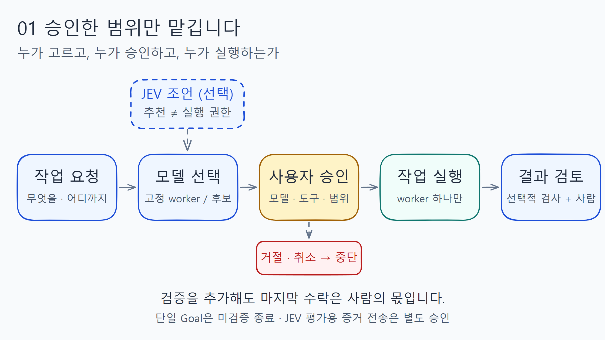
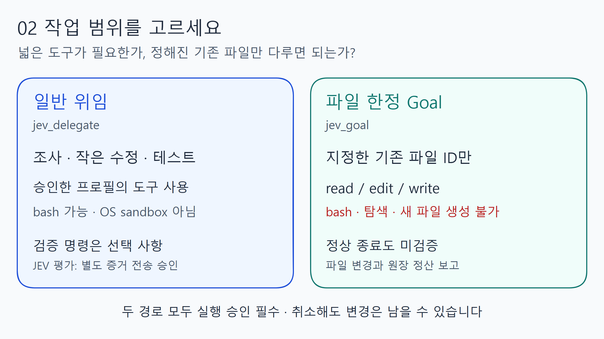

# Archived diagrams — 역사 자료

These two static diagrams describe historical permission boundaries, not current feature advertising or proof of live execution. Retired Goal APIs remain unregistered. Existing editable sources, static SVG/PNG files and geometry checks are preserved for the unchanged documentation regression tests.

| Diagram | PNG | SVG | Editable source | Validation |
| --- | --- | --- | --- | --- |
| Workflow | [PNG](workflow.png) | [SVG](workflow.svg) | [Project](workflow.excalimate.json) | [Report](workflow.validation.json) |
| Scope | [PNG](scope.png) | [SVG](scope.svg) | [Project](scope.excalimate.json) | [Report](scope.validation.json) |

PNG dimensions are2240x1260; the accompanying [export report](export-report.json) records the original static rendering checks. The SVGs are bounded and contain no scripts, foreign HTML or remote resources. The two images were visually reviewed for this public snapshot; internal UI screenshots and personal-path development reports are not distributed.

The original drawings used [Excalimate](https://github.com/excalimate/excalimate)0.5.1 at `e12ec8001148d09c750badf71d3da4c97fb3fbbb` (MIT), with local-only rendering. Excalimate is not a runtime dependency and is not bundled here. Source/export helpers remain under `scripts/figures/` for regression/source continuity; they require a separately prepared explicit upstream checkout, never an automatic tool/model download.

The diagrams and retained historical reports are explanatory/regression data, not current installation instructions, evidence of this release's physical TUI behavior, a saved approval or a general task-quality guarantee. See [current usage](../usage.md) and [verification](../verification.md).
